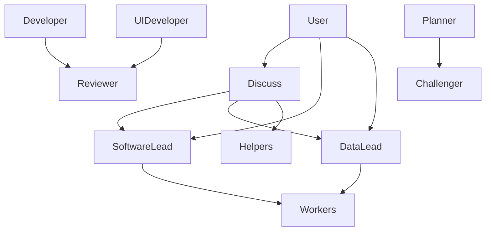

# Architecture

This document defines the design of the private `copilot-workbench` Agent Plugins package for GitHub Copilot in VS Code.
[Project status](PROJECT-STATUS.md) records implementation progress, the roadmap, and the near-term queue.
[Open issues](OPEN-ISSUES.md) records verified limitations and unresolved decisions.
The [README](README.md) inventories the components available in the current worktree.

## Purpose and boundaries

The package supports the owner's data-science work, scientific exploration, and hobby software projects.
Python is the owner's general-purpose stack; other technologies depend on the project.
The reusable package stays independent of project-specific datasets, database targets, credentials, and absolute paths.

| Layer | Ownership |
| --- | --- |
| Plugin package | Reusable agents, skills, scoped rules, MCP configuration, and bundled resources. |
| Project repository | Technology-specific extensions, project instructions, source code, and durable project records. |
| Local environment | Credentials, saved connections, service configuration, and runtime dependencies. |
| Temporary task state | Session and delegated-work summaries under the layout defined by [task-context](skills/task-context/SKILL.md). |

The plugin uses root [plugin.json](plugin.json), optional root [mcp.json](mcp.json), immediate `skills/<name>/SKILL.md` files, and Copilot extensions under `com.github.copilot/`.
The authoring repository's `.github/` customizations maintain this repository and are excluded from distribution.
Root architecture, status, and issue records are development documentation rather than runtime components.

Design principles are personal use, technology independence, modular components, project-owned extensions, and proportionate model and context costs.
An extension that introduces workers also supplies an entry agent that lists them, because an agent's allowed worker pool is explicit.

## Agent roles

Chat and lead agents are entry agents that the user can select.
Workers execute one bounded assignment and return evidence, artifacts, or blockers to their caller.

| Entry agent | Responsibility |
| --- | --- |
| `discuss` | Clarifies an unfinished request through conversation and bounded exploration, then hands it to a lead or produces a self-contained prompt on request. |
| `software-lead` | Owns the approach and integration of software changes, working directly or delegating bounded tasks. |
| `data-lead` | Owns the analytical question, evidence, synthesis, uncertainty, and conclusion. |

Discuss writes only temporary task notes through `task-context`.
The leads own approval questions and the final result; workers return missing decisions rather than interviewing the user.

| Worker | Responsibility | Boundary |
| --- | --- | --- |
| `explorer` | Locate workspace evidence for one question. | Read-only; reports locations and findings. |
| `database-explorer` | Discover and profile database objects and draft queries. | Read-only database work; does not own analytical conclusions. |
| `data-explorer` | Discover and profile local dataset files. | Preserves source files and reports the code behind profiles. |
| `researcher` | Gather sourced external evidence. | Reports support, conflicts, and gaps without choosing an action. |
| `planner` | Produce an executable plan with settled implementation decisions. | Writes no implementation code; may consult Challenger. |
| `developer` | Implement and check a bounded software change. | Scope and publication rights come from the brief; may consult Reviewer. |
| `ui-developer` | Implement and visually check interface changes. | Browser checks cover the changed experience; may consult Reviewer. |
| `reviewer` | Assess a finished result against its goal. | Reports defects and verification limits without repairing the result. |
| `challenger` | Test one consequential decision or framing. | Returns the strongest objection and the cheapest discriminating check. |

Read-only workers with file-creation tools may write only an explicitly assigned task result.
Read-only behavior enforced by instructions is distinct from tool-level restrictions: query and execution tools can have broader capabilities.

## Delegation and checking

Every delegation is one-shot and self-contained, following [brief-subagent](skills/brief-subagent/SKILL.md).
The caller supplies the question, scope, inputs, constraints, expected result, and any assigned result path.
The lead keeps analytical conclusions and integration decisions rather than treating worker output as independent proof.

Independent work may run concurrently, but two writers never work on overlapping files at the same time.
The lead works directly when a brief would cost more than a simple sequential change.
An open owner question blocks only the work that depends on its answer.

A brief can require review; otherwise a producer decides whether its checker adds value and reports the decision.
Developer and UI Developer call Reviewer, and Planner calls Challenger.
Checkers do not delegate, and workers do not call other implementation writers.
One checker round returns findings with accepted fixes or reasons for leaving them open; unresolved findings return to the lead.

An agent definition states its role, boundaries, workflow, allowed workers, and output.
Entry agents also carry the shared owner-facing communication style.
The plugin-specific construction conventions live in the `build-*` skills, while [copilot-customization](skills/copilot-customization/SKILL.md) remains independent of this architecture.

## Tools and models

Tool lists grant only the capabilities needed by each role.
Database roles receive database tools; UI Developer receives browser tools; Researcher receives web and repository-search tools.
Producer workers use current documentation before relying on external library or tool APIs.
Data Explorer uses execution tools to read dataset formats, so its source-preservation boundary is instructional.

Entry-model guidance lives in [build-entry-agent models](skills/build-entry-agent/references/models.md).
Worker tiers and escalation guidance live in [build-worker-agent model tiers](skills/build-worker-agent/references/model-tiers.md).
Each agent's frontmatter remains the executable declaration of its available models and tools.

Leads use strong models; workers default to the tier that fits their role and may offer a stronger or faster alternative.
The caller uses the default unless the assignment needs escalation within the worker's declared model list.
Missing input and owner decisions are blockers rather than reasons to buy a stronger model.
Reviewer is at least as strong as the author, and Challenger uses a different model family when that independence is required.

## Skills

| Group | Skills | Responsibility |
| --- | --- | --- |
| General customization | `copilot-customization` | Artifact choice, metadata, writing guidance, and review. |
| Plugin extensions | `build-entry-agent`, `build-worker-agent`, `build-skill` | User-invoked interviews and construction of compatible agents or project skills. |
| Coordination | `brief-subagent`, `task-context`, `interview-me` | Self-contained assignments, temporary state, and user-invoked intent clarification. |
| Execution | `run-python`, `redshift`, `sql-server` | Runtime selection and bounded, read-only database workflows. |

`build-skill` creates project-specific capabilities in the target project's `.github/skills/`.
The package's own generic artifacts are maintained in this repository.
`interview-me` is user-invoked; Discuss performs its own conversational interviewing.
`task-context` does not replace project documentation or durable analytical artifacts.

## Database access

Both database skills resolve targets from the user's request or explicit answer and return missing target details to the caller when delegated.
The SQL Server workflow selects a matching saved profile and verifies the active server and database.
The Redshift workflow prefers MCP and permits its bundled Python fallback only for the documented tool, transport, authentication, or access failures.
The fallback uses locally populated connection variables and requires confirmation that they identify the same requested target.

One execution contains one read-only query, with the Redshift skill also permitting an execution plan.
Exploration and quality checks are scoped to unknown facts that can affect the answer.
The report states provenance, bounds, truncation, and verification limits; samples do not establish population completeness.

The bundled MCP configuration retains the local AWS profile label `redshift-mcp`; local configuration supplies its credentials and region.
Read-only database permissions reinforce the instructions, because the underlying tools and runner are not restricted SQL authorization engines.
`database-explorer` loads the skill for each target system and owns the Redshift fallback for delegated exploration; it returns a required configuration confirmation as a blocker, and the delegating agent supplies the confirmation in a new brief.

## Scoped rules

| Rule | Responsibility |
| --- | --- |
| Markdown | Ordinary document syntax and prose, excluding customization files and skill resources. |
| Python | Owner-run task-script conventions, with reusable code governed by its project. |
| SQL | The text of one read-only SQL Server or Redshift query; execution and connection handling remain in the skills. |

General behavior belongs in agents and skills rather than language rules.
No Git rule is currently shipped.

## Repository lifecycle

`develop` is the authoring branch; `main` is the intended package-only distribution branch and remains the repository default.
Branch protection is intentionally disabled by owner decision.
Release readiness and publication are pending; the owner-selected first version is `0.1.0`, while the manifest still has its retained value.
Temporary task state, source references, and repository-local customizations stay outside the distribution payload.
The operational roadmap and short descriptions of deferred capabilities live only in [project status](PROJECT-STATUS.md).

## Design references

The previous design used the following sources as structural inspirations rather than tone or output templates.
New specifications can consult current sources without depending on archived copies in this repository.

| Role | Structural inspirations |
| --- | --- |
| Entry agents | [Gem Orchestrator](https://github.com/github/awesome-copilot/blob/main/agents/gem-orchestrator.agent.md), [Orchestrator](https://gist.github.com/burkeholland/0e68481f96e94bbb98134fa6efd00436), [RUG](https://github.com/github/awesome-copilot/blob/main/agents/rug-orchestrator.agent.md), and [AI Team Producer](https://github.com/github/awesome-copilot/blob/main/agents/ai-team-producer.agent.md). |
| Discuss | [Product Manager](https://github.com/github/awesome-copilot/blob/main/agents/se-product-manager-advisor.agent.md), [Idea Generator](https://github.com/github/awesome-copilot/blob/main/agents/simple-app-idea-generator.agent.md), and [VS Code planning](https://code.visualstudio.com/docs/agents/planning). |
| Explorer and data explorers | [Gem Researcher](https://github.com/github/awesome-copilot/blob/main/agents/gem-researcher.agent.md), [Context Architect](https://github.com/github/awesome-copilot/blob/main/agents/context-architect.agent.md), [Kusto Assistant](https://github.com/github/awesome-copilot/blob/main/agents/kusto-assistant.agent.md), [MongoDB Performance Advisor](https://github.com/github/awesome-copilot/blob/main/agents/mongodb-performance-advisor.agent.md), and [Research Harness Engineer](https://github.com/github/awesome-copilot/blob/main/agents/research-harness-engineer.agent.md). |
| Researcher | [Context7 Expert](https://github.com/github/awesome-copilot/blob/main/agents/context7-expert.agent.md), [Doublecheck](https://github.com/github/awesome-copilot/blob/main/agents/doublecheck.agent.md), and [Task Researcher](https://github.com/github/awesome-copilot/blob/main/agents/task-researcher.agent.md). |
| Planner | [Gem Planner](https://github.com/github/awesome-copilot/blob/main/agents/gem-planner.agent.md) and [One-Shot Feature Issue Planner](https://github.com/github/awesome-copilot/blob/main/agents/one-shot-feature-issue-planner.agent.md). |
| Developer | [Coder](https://gist.github.com/burkeholland/0e68481f96e94bbb98134fa6efd00436), [SWE](https://github.com/github/awesome-copilot/blob/main/agents/swe.agent.md), and [Gem Implementer](https://github.com/github/awesome-copilot/blob/main/agents/gem-implementer.agent.md). |
| UI Developer | [Gem Designer](https://github.com/github/awesome-copilot/blob/main/agents/gem-designer.agent.md), [Gem Browser Tester](https://github.com/github/awesome-copilot/blob/main/agents/gem-browser-tester.agent.md), and [DevTools Regression Investigator](https://github.com/github/awesome-copilot/blob/main/agents/devtools-regression-investigator.agent.md). |
| Reviewer | [Gem Reviewer](https://github.com/github/awesome-copilot/blob/main/agents/gem-reviewer.agent.md), [AI Team QA](https://github.com/github/awesome-copilot/blob/main/agents/ai-team-qa.agent.md), and [QA](https://github.com/github/awesome-copilot/blob/main/agents/qa.agent.md). |
| Challenger | [Critical Thinking](https://github.com/github/awesome-copilot/blob/main/agents/critical-thinking.agent.md), [Devil's Advocate](https://github.com/github/awesome-copilot/blob/main/agents/devils-advocate.agent.md), and [rubber duck](https://docs.github.com/en/copilot/concepts/agents/copilot-cli/rubber-duck). |
